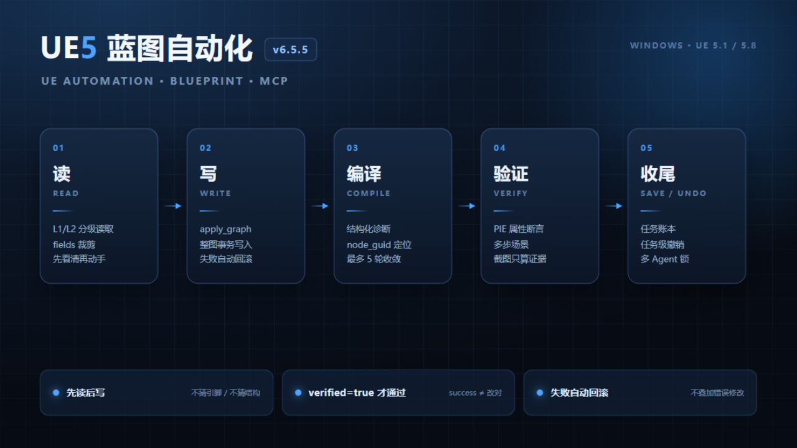

# UE5 全自动蓝图工具链（ue5-automation）

[English](README.md) | **简体中文**

> 让 AI Agent（或脚本）**真正操作 UE 编辑器**：节点级蓝图编写、材质、UMG、
> PIE 运行时验证——所有写操作读回复验（fail-loud，绝不假成功）。
>
> **覆盖 UE 5.1 – 5.8。** Epic 官方内置 MCP 只随 5.8+ 提供——如果你的项目
> （或团队的手游线）还在 5.1–5.7，这是覆盖 5.1–5.8 的方案。5.1 与 5.8 随包预编译桥，
> 零编译。
>
> **版本 v6.5.4**（2026-10-28）· 101 条白名单命令 / 34 个 MCP 工具 · 离线 820 passed
>
> [](https://github.com/miracle1814/ue5-automation/releases/latest)
> [](https://github.com/miracle1814/ue5-automation/actions/workflows/tests.yml)
> [](LICENSE)
> [](https://skillhub.cn/skills/user_9249b15b/ue5-automation)
> [](https://glama.ai/mcp/servers/miracle1814/ue5-automation)
>
> **下载 v6.5.4：** [移植包](https://github.com/miracle1814/ue5-automation/releases/download/v6.5.4/ue5-automation-v6.5.4-portable.zip) · [Release 说明](https://github.com/miracle1814/ue5-automation/releases/tag/v6.5.4) · [SkillHub 页面](https://skillhub.cn/skills/user_9249b15b/ue5-automation)
>
> English: [README.md](README.md) · 快速开始：[START-HERE.zh-CN.md](START-HERE.zh-CN.md)
>
> SkillHub 技能包已更新到 **6.5.8**（仅文档；运行时仍为 **v6.5.4**）。


*读 → 写 → 编译 → 验证 → 收尾；`verified=true` 才算通过。*

> ⭐ 如果这个工具帮你省了时间，欢迎点个 Star，让更多 UE 开发者找到它。

---

## 为什么做这个

绝大多数"AI 控制 UE"方案卡在同一堵墙上：**Python 摸不到 `UEdGraph`**。
建个资产演示一天就能跑通，但节点级建图、可靠连线、"操作真的生效了"这三件事，
才是项目的生死线。本工具链的答案：

- **C++ 桥插件**（编辑器级 UFUNCTION）：节点创建、基于 GUID 的引脚/连线编辑、
  控件树读写、材质表达式枚举——这些是引擎 Python **物理上做不到**的事。
- **回读验证纪律**：每个写操作**读回并比对**（不一致即 fail-loud，绝不假成功）；
  连线对照实时拓扑校验；编译结果用日志模式扫描回读。
- **运行时行为验证**：启动 PIE → 读活体 Actor 状态 → 带回读比对地传送 → 停止。
  证明逻辑**真的在跑**，而不只是编译通过；`verify_scenario` 把
  等待/断言/日志/截图编成可产出 JUnit 的验收场景。
- **多 Agent 协作（v6.5）**：幂等键（重试不重复写）、会话锁 + 任务锁、
  写回执（before/after 指纹）。
- **经得起推敲的安全模型**：仅监听 localhost、token 鉴权、101 条命令白名单
  （无任意代码执行）、8MB 请求体上限、事务日志、回滚。

## 与 Epic 官方 Unreal MCP（5.8+）的关系

| | 官方 MCP（5.8+） | ue5-automation |
|:--|:--|:--|
| 引擎版本 | 仅 5.8+ | **5.1 – 5.8** |
| 蓝图图编辑 | 对象级工具 | **节点级**（创建/连线/验证，GUID 定位） |
| 写操作验证 | 返回成功即成功 | **读回比对，fail-loud** |
| 事务回滚 | ✗ | **✓ 原子构建，失败自动回滚** |
| 鉴权 | 无（仅回环） | **token 鉴权 + 101 条命令白名单 + 审计日志** |
| 编辑器关闭时可用 | ✗ | 部分（分析/日志工具） |
| 在 5.8 上 | — | **与官方协同**（ue58-extras 在官方之上加 8 个节点级工具） |

在 5.8 上两者互补：场景/资产操作交给 Epic 官方工具集，节点级建图和带验证的写操作
交给本桥。在 5.1–5.7 上，这是唯一选项。

## 能力总览

| 能力域 | 能做什么 |
|:--|:--|
| 🔍 蓝图分析 | 类/变量/CDO/节点图/连线 → Markdown + Mermaid 报告 |
| 🏗️ 蓝图创建 | 资产+变量+组件+接口+事件+函数节点+连线+编译（原子化，失败自动回滚） |
| ✏️ 增量编辑 | 引脚默认值 / 连线断线（拓扑三重验证）/ 删节点（引用检查）/ 事务回滚 |
| 🎨 材质 | 创建 → 表达式（参数/运算/采样）→ 连主属性 → 编译 → 实例改参 |
| 🧩 UMG 控件蓝图 | 创建 → 搭控件树（Panel/Text/Button…）→ 设属性 → 图内逻辑复用蓝图能力 |
| ▶️ PIE 运行时验证 | 启动/状态/运行时对象枚举/属性读取/传送回读/停止 |
| 🖥️ Actor 与关卡 | 查询 / 生成（可选 mobility）/ 变换 / 读属性 |
| 🩺 报错诊断 | 引擎日志解析 + 19 条错误模式库 + 增量日志读取 |
| 📐 项目评估 | 全项目扫描：规模/复杂度/耦合/循环依赖/热点 |
| ⚡ 批量执行 | 多步操作压成单次请求 |

## 引擎版本矩阵（如实声明）

| 引擎 | 读/评估/诊断 | 蓝图节点级写 | 材质/UMG | MCP 接入 |
|:--|:--|:--|:--|:--|
| **5.1.x** | ✅ 随包即用 | ✅ **随包预编译桥**（实测 5.1.1） | ✅ | ✅ `/mcp` |
| 5.2–5.5 | ✅ | ⚠️ 自助重编译桥（源码随包）：`bridge/BlueprintPythonBridge/Source/build_for_engine.bat` | ⚠️ 同左 | ✅ |
| 5.6 / 5.7 | ✅ | ❔ 未验证（结构兼容） | ❔ | ✅ |
| **5.8** | ✅ | ✅ **随包预编译桥**（`bridge/prebuilt-5.8/`，实测 5.8.2） | ✅ | ✅ 官方 MCP + `bridge/ue58-extras/`（8 工具） |

宿主机另需：Python 3.10+（与 UE 内嵌解释器无冲突，脚本跑在宿主侧）、编辑器启用
**Python Editor Script Plugin**、勾选 **Remote Execution**。

## 部署（3 步 + 1 验证）

```cmd
:: ① 安装 Python 依赖（install_dependencies.bat 也会自动尝试部署桥）
install_dependencies.bat

:: ② 若①未成功，手动把桥部署到你的 UE 项目（项目级，无需管理员）
cd bridge\BlueprintPythonBridge
python deploy.py --target "你的UE项目路径"
::   5.8 用户改用：bridge\prebuilt-5.8\ 里的两个文件
::   （DLL + UnrealEditor.modules 必须成对放到 <项目>\Plugins\BlueprintPythonBridge\Binaries\Win64\）

:: ③ UE 侧配置：Edit → Plugins 启用 "Python Editor Script Plugin"；
::    Project Settings → Plugins → Python → 勾选 Enable Remote Execution → 重启编辑器

:: ④ 验证
cd ..\..\skill\ue5-automation\scripts
python check_ue_version.py        :: 版本自检（退出码 0 = 5.1 可直接用）
python ue5_runner.py health       :: 链路健康检查（输出 bridge_apis 列表即通）
```

然后一条命令把 MCP 代理注册进你的 AI 客户端（自动探测 Claude Desktop / Cursor /
Claude Code / VS Code / Windsurf / Codex；写入前自动备份配置）：

```cmd
python skill\ue5-automation\scripts\install_mcp.py
```

> **⚠️ 部署/更换 DLL 后必须重启 UE 编辑器**，否则不会加载。

## 接入 AI（MCP）

本工具包**本身就是一个 MCP 服务器**，任意 MCP 客户端直连：

- **UE 5.1–5.5**：`http://127.0.0.1:8889/mcp`（随包端点；桥在首次写操作时自动启动）
  - 客户端配置示例（ZCode，Claude Desktop / Cursor 同理）：

    ```json
    "ue5-automation": {
      "type": "http",
      "url": "http://127.0.0.1:8889/mcp",
      "headers": { "X-Skill-Token": "<%APPDATA%\\ue5_bridge\\token 文件内容>" }
    }
    ```

  - 连上即得 **34 个 MCP 工具**（`ue5_build_blueprint` / `ue5_apply_blueprint_graph`
    整图声明式写入 / `ue5_start_pie` / `ue5_screenshot` 截图视觉自检闭环 /
    `ue5_read_logs` / `ue5_run_batch` / `ue5_execute_command` 全量透传）+
    **101 条白名单命令**。
  - 详细配置见 `skill/ue5-automation/docs/MCP-ACCESS.md`。
- **UE 5.8**：引擎自带官方 MCP 服务器（`http://127.0.0.1:8000/mcp`，需在项目设置开
  `bAutoStartServer=True`）+ 安装 `bridge/ue58-extras/` 插件（8 个工具；配合随包
  预编译桥，节点级图工具同样可用）。
- **stdio 客户端（Claude Desktop 等）**：用随包的 stdio 代理——它在本地提供完整
  工具目录（不需要 UE 在线即可握手/列工具），调用时转发给编辑器内的桥，token 自动
  读取。不支持自定义 HTTP 头的客户端即插即用：

  ```json
  {
    "mcpServers": {
      "ue5-automation": {
        "command": "python",
        "args": ["C:/path/to/ue5-automation/skill/ue5-automation/scripts/ue5_mcp_stdio.py"]
      }
    }
  }
  ```

然后直接对 AI 说：

> "创建一个带碰撞球的拾取物品蓝图，然后在 PIE 里验证拾取逻辑。"

### 观测：管理端仪表盘（只读）

AI 干活时，浏览器打开 `http://127.0.0.1:8889/ui?token=<%APPDATA%\ue5_bridge\token 文件内容>`
即可只读查看 agent 的工作过程——任务流水（每步工具调用/耗时/状态）、图纸视图
（节点连线、写操作高亮呼吸、编译错误钉节点）、验证墙（写操作 verified/warnings
卡片 + 编译轮次计数）、报告列表与审计包（zip）一键导出。全部只读 GET，任何异常
不阻塞 agent 主路径；事件同时落盘 `%APPDATA%\ue5_bridge\sessions\`（JSONL）供事后审计。

## 命令行用法（不接 AI 也能用）

```cmd
cd skill\ue5-automation\scripts
python ue5_runner.py health
python ue5_runner.py read /Game/BP_Test --level L2
python ue5_runner.py build spec.json
python blueprint_editor.py update  /Game/BP_Test PrintString InString "Hello"
python blueprint_editor.py connect /Game/BP_Test BeginPlay then PrintString execute
python log_parser.py --log "%PROJECT%\Saved\Logs\YourProject.log" --output diag.json
python analyzer.py --input reader_out.json --summary
```

## 执行链（AI 实际在做什么）

```
需求 → 预检（引擎/版本/桥）→ 读现状（节点/GUID/变量）→ 执行变更（每步回读验证）
     → 行为验证（PIE：活体状态/传送回读）→ 交付（Markdown + Mermaid 报告 + 事务日志）
     → 清理（只做作用域内保存，绝不保存整个工程）
```

我们把"返回 true 但其实什么都没做"视为编辑器自动化的头号大罪——
所以每个写操作都强制回读比对，不一致就大声报错。

## 目录说明

```
├── bridge/                          引擎侧的"手"
│   ├── BlueprintPythonBridge/       C++ 桥插件（编辑器级 UFUNCTION）
│   │   ├── Binaries/Win64/          UE 5.1 预编译 DLL（901,120 B · 2026-09-18 编译）
│   │   └── Source/                  完整源码 + build_for_engine.bat（5.2–5.8 自编译）
│   ├── prebuilt-5.8/                UE 5.8 预编译 DLL（+ UnrealEditor.modules，成对部署）
│   └── ue58-extras/                 5.8 官方 MCP 的工具集插件（8 工具）
├── skill/ue5-automation/            宿主侧的"脑"：桥客户端、/mcp 端点、runner、
│                                    蓝图读写/创建器、分析器、日志解析、preflight、
│                                    文档、报告模板、tests/（离线测试套件）+ conftest.py
├── manifest.json                    发布清单（逐文件 MD5，供下载后校验）
└── CHANGELOG.md                     版本历史
```

## 四种工作模式

| 模式 | 对 AI 说 | 产出 |
|:--|:--|:--|
| 🔍 蓝图分析 | "分析 /Game/BP_xxx" | 节点拓扑 + Mermaid 流程图 + 关联资产报告 |
| 🏗️ 蓝图创建 | "创建一个可拾取物品蓝图" | 方案确认 → 自动创建 + 连线 + 编译 + PIE 验证 |
| 🩺 报错诊断 | "报错了" + 贴日志 | 根因定位 + 自动修复 / 诊断报告 |
| 📐 项目评估 | "分析项目 /Content/..." | 架构指标 + 热力图 + 问题清单 |

## 前置要求

| 组件 | 要求 | 说明 |
|:--|:--|:--|
| Python（宿主侧） | 3.10+ | 跑 skill 脚本 / MCP 端点 |
| UE5 | 5.1 – 5.8（见版本矩阵） | 5.1 / 5.8 随包零编译 |
| Python Editor Script Plugin | 已启用 | UE 内执行 Python |
| Remote Execution | 已勾选 | UDP 读通道 |
| BlueprintPythonBridge | 本包自带 | C++ 节点级读写 |
| 多 Agent 框架（如 QwenPaw） | **可选** | standalone 单机脚本调用完全可用，不依赖任何 Agent 框架 |

## 离线测试

仓库自带离线测试套件（不需要打开编辑器）：

```cmd
pip install -r requirements-dev.txt
python -m pytest skill/ue5-automation/tests --timeout=90
```

当前基线：**820 passed / 0 failed**（95 skipped = 需要真机编辑器的在线用例）。

## 常见问题

**Q: 需要手动启动 `ue5_bridge.py` 吗？**
A: 不需要。首次写操作时调用方会自动检测并通过 Remote Execution 在 UE 内远程启动。

**Q: 调用返回 403？**
A: token 不对：读 `%APPDATA%\ue5_bridge\token`（首次启动服务时自动生成）。

**Q: DLL 部署后不生效？**
A: 关编辑器 → 部署 DLL → 重开编辑器。

**Q: ue_send 连不上 UE？**
A: ① 编辑器已开目标项目；② Remote Execution 已勾选；③ 没有模态对话框挡着（崩溃恢复框点"跳过恢复"）。

**Q: PIE 里物体不动？**
A: 组件是 Static mobility：`spawn_actor` 时传 `mobility="movable"`。

**Q: `partial_success` 是什么意思？**
A: 蓝图半成品已创建（资产/变量/组件完成），节点/连线/编译未全部成功；
蓝图路径见返回的 `asset_path` 字段，可手动补全或让 AI 继续。

## 最小成功路径

1. 从 [Releases](https://github.com/miracle1814/ue5-automation/releases/latest) 下载移植包，解压运行 `install.bat`，把 `.uproject` 拖进窗口。
2. 重启编辑器，`health` 返回 `bridge_loaded: true`。
3. 建一个空蓝图，用 `apply_graph` 写入 `BeginPlay → PrintString`，`compile_and_diagnose` 编译，`get_pin_default_value` 读回引脚。
4. `save_asset` 落盘。整条闭环就是：**写入 → 编译 → 读回 → 保存**。

完整命令契约见 [`SKILL.md`](skill/ue5-automation/SKILL.md)；常见故障见 [`TROUBLESHOOTING.md`](packaging/skillhub/ue5-automation/references/TROUBLESHOOTING.md)。

## 企业合作

核心代码 Apache-2.0。以下工作可付费合作：企业集成、UE 5.2–5.7 桥重编译与适配、CI/资产治理流水线、团队培训、定制工具链。请在 GitHub 发标题带 `[Commercial]` 的 Issue，或联系 [@miracle1814](https://github.com/miracle1814)。

## License

Apache-2.0 —— 见 [LICENSE](LICENSE) 与 [THIRD_PARTY_NOTICES.md](THIRD_PARTY_NOTICES.md)。

> Unreal® Engine 是 Epic Games, Inc. 的商标。本项目为独立开发者工具，与 Epic Games
> 无隶属或背书关系。引擎头文件/二进制仍受 Epic EULA 约束；Apache-2.0 只覆盖本项目
> 原创源码。

## 致谢

构建于 UE 编辑器的 Python 与远程执行接口之上，并与官方
[ModelContextProtocol 插件](https://github.com/EpicGames/UnrealEngine)（5.8+）集成。
